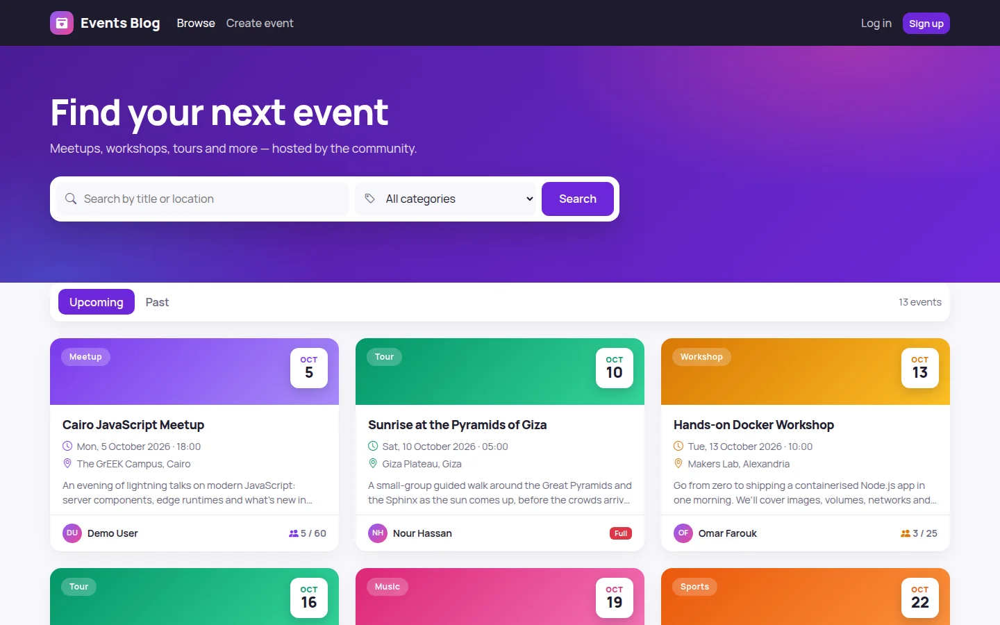
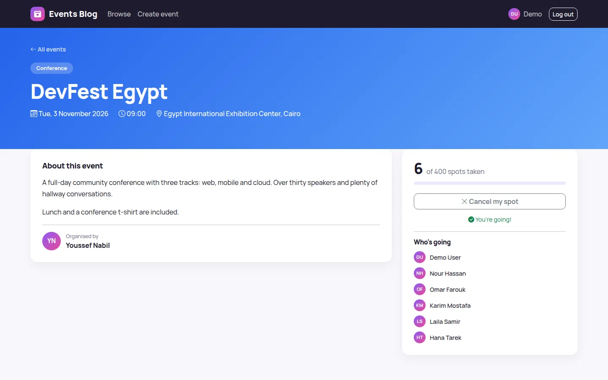
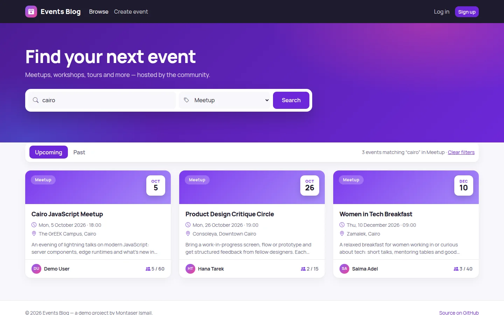
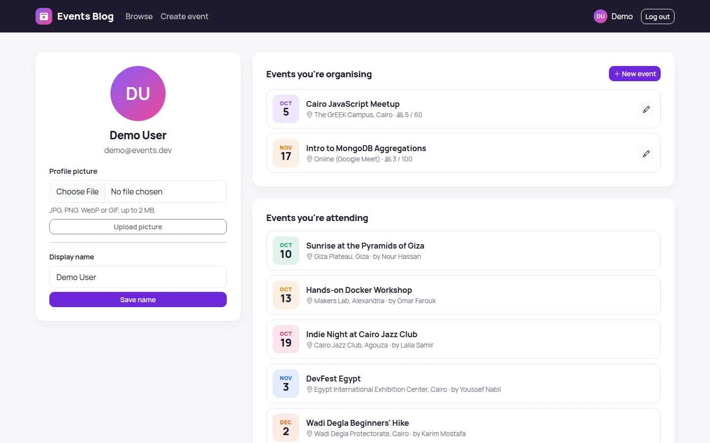
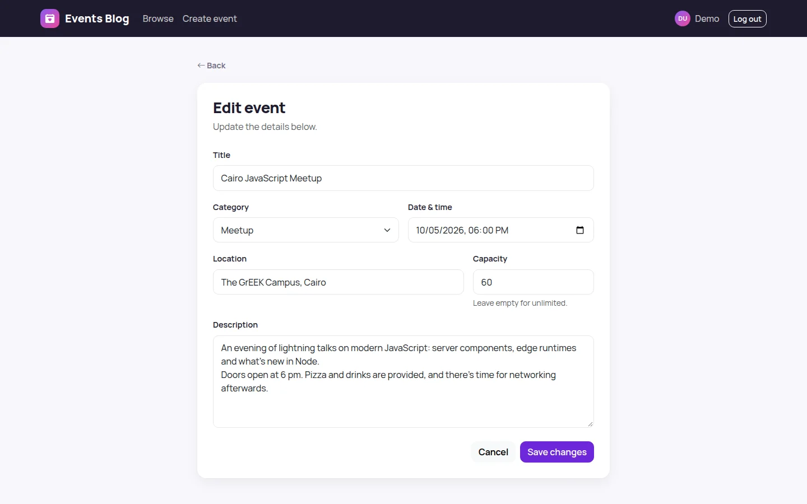
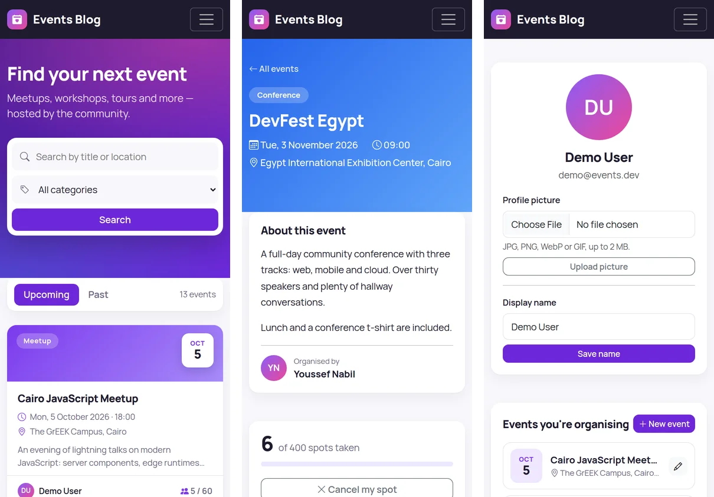

# Events Blog

A community events app: create events, discover what's on, and RSVP. It's server-rendered with **Node.js, Express, MongoDB (Mongoose), EJS and Passport**, on a Bootstrap 5 UI.

> **Background.** This started as a follow-along project from a Node.js tutorial by Abdulaziz Alzaabi (basic event CRUD with login). I later rebuilt it: I fixed its security problems, restructured the code, redesigned the interface and added the features under [What I changed](#what-i-changed).



| Event page with RSVP | Search and filters |
| --- | --- |
|  |  |
| **Profile: your events and avatar** | **Create / edit an event** |
|  |  |



---

## Features

- **Browse:** upcoming and past tabs, search by title or location, a category filter and pagination.
- **Create and manage events:** title, category, date and time, location, capacity and description, validated on both client and server.
- **RSVP:** attend or cancel with one click, with live spot counts, a capacity bar and "Full" states. Capacity is enforced atomically in the database, so two people can't take the last spot.
- **Accounts:** sign up, log in and log out with Passport sessions stored in MongoDB; after logging in you return to the page you asked for.
- **Profile:** change your display name, upload a profile picture (with a live preview), and see the events you organise and attend.
- **Responsive and accessible:** works from 390 px upwards, with a skip link, labelled controls, keyboard-focusable cards and reduced-motion support.

## What I changed

### Security
| Before | After |
| --- | --- |
| Database username and password hardcoded in `config/database.js` | Configuration from environment variables (`.env`, never committed); the app refuses to start without them |
| `express.static("node_modules")` exposed every installed package over HTTP | Only `/public` and processed avatars are served; libraries load from a CDN with SRI hashes |
| Any logged-in user could edit or delete **anyone's** event (only the buttons were hidden) | Ownership is checked on the server for edit, update and delete |
| Avatar upload: no login check, any file type, any size, original filename kept | Login required; image types only; 2 MB limit; the file is re-encoded with Sharp (which rejects non-images) and stored under a random name |
| No CSRF protection; logout was a `GET` link | Synchroniser-token CSRF protection on every state-changing request; logout is a `POST` |
| Session secret was the string `"lorem ipsum"`, sessions in memory | Secret from the environment; sessions stored in MongoDB; `httpOnly`, `sameSite` cookies, `secure` in production |
| Login revealed whether an email was registered | One generic error message; rate limiting on login and signup |
| No security headers | helmet with a strict Content Security Policy (no inline scripts or styles) |
| `bcrypt-nodejs` (unmaintained since 2013) | `bcryptjs`, with hashing done asynchronously in a model hook |

### Bugs fixed
- Creating an event with invalid data **saved it anyway** (a missing `return` after the validation redirect) and logged "headers already sent".
- Bootstrap 5 was installed but the templates used Bootstrap 4 markup, so the **mobile menu button did nothing** and many spacing classes had no effect.
- The fixed-position footer covered the bottom of long pages.
- Events were listed in insertion order with five per page in rows of three; they're now sorted by date, six per page.
- Search input is escaped before it is used in a regular expression.
- Logging out could crash: the handler called `next` without declaring it.

### Added
- RSVPs with capacity, categories, search, upcoming/past tabs, profile pages, a display name, friendly 404 and error pages, a seed script with dates relative to today, and Docker Compose for MongoDB.

## Run it locally

Requirements: Node.js 18.11+ and Docker (or any MongoDB instance).

```bash
git clone https://github.com/montaser-hub/events-blog.git
cd events-blog
npm install
cp .env.example .env        # then set SESSION_SECRET (e.g. `openssl rand -hex 32`)
npm run db:up               # MongoDB on localhost:27019 (Docker)
npm run seed                # 8 people and 16 events
npm start                   # http://localhost:3000
```

**Demo login:** `demo@events.dev` / `test1234`

## Routes

| Method | Path | Notes |
| --- | --- | --- |
| GET | `/events` | List. Query: `q`, `category`, `when=past`, `page` |
| GET | `/events/new` | Create form (login required) |
| POST | `/events` | Create (login required) |
| GET | `/events/:id` | Event page |
| GET | `/events/:id/edit` | Edit form (organiser only) |
| PUT | `/events/:id` | Update (organiser only) |
| DELETE | `/events/:id` | Delete (organiser only) |
| POST | `/events/:id/attend` | Toggle RSVP (login required) |
| GET, POST | `/users/login`, `/users/signup` | Authentication |
| POST | `/users/logout` | Log out |
| GET, POST | `/users/profile` | Profile page; update display name |
| POST | `/users/avatar` | Upload profile picture |

HTML forms send `PUT` and `DELETE` through a hidden `_method` field.

## Project structure

```
server.js         entry: connects to MongoDB, starts the server, graceful shutdown
app.js            Express app: security headers, sessions, CSRF, routes, error pages
config/           environment validation, database connection, Passport strategy
middleware/       auth and ownership guards, CSRF, upload handling, validators
models/           User, Event (Mongoose)
routes/           events, users
views/            EJS templates, partials and formatting helpers
public/           stylesheet and client-side script
seed/             sample data
```

## License

[MIT](LICENSE) © Montaser Ismail
